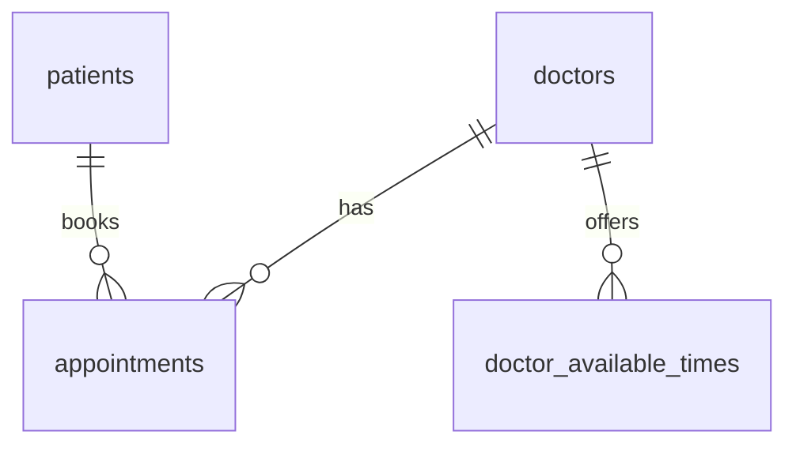

# Smart Clinic Management System - Database Schema Design

This design separates relational clinic operations in MySQL from prescription documents in MongoDB. It is a blueprint for the later model and database labs, not a claim that the databases or controls are already implemented. All sample data is fictional.

## MySQL Database Design

MySQL stores patients, doctors, administrators, appointments, and doctor availability. These records have stable fields and relationships that benefit from foreign keys and explicit constraints. The four core tables follow the starter's Patient, Doctor, Appointment, and Admin models; a fifth table stores the Doctor model's collection of available times.

### Table: patients

| Column | Data type | Keys and constraints | Purpose |
| --- | --- | --- | --- |
| id | BIGINT | PRIMARY KEY, AUTO_INCREMENT | Patient identifier; maps to Java Long. |
| name | VARCHAR(100) | NOT NULL | Patient's full name. |
| email | VARCHAR(254) | NOT NULL, UNIQUE | Patient login identifier. |
| password | VARCHAR(255) | NOT NULL | Encoded password hash, never a plaintext password. |
| phone | VARCHAR(10) | NOT NULL | Ten-digit phone number, following the starter validation rule. |
| address | VARCHAR(255) | NOT NULL | Patient address. |

Validate nonblank required text, names of 3-100 characters, email format, and exactly ten phone digits in application code. Store phone numbers as text to preserve leading zeros. The ten-digit restriction is a course requirement, not a general international phone-number model. Trim and consistently normalize login email addresses before checking uniqueness and saving them.

### Table: doctors

| Column | Data type | Keys and constraints | Purpose |
| --- | --- | --- | --- |
| id | BIGINT | PRIMARY KEY, AUTO_INCREMENT | Doctor identifier; maps to Java Long. |
| name | VARCHAR(100) | NOT NULL | Doctor's full name. |
| specialty | VARCHAR(50) | NOT NULL | Medical specialization. |
| email | VARCHAR(254) | NOT NULL, UNIQUE | Doctor login identifier. |
| password | VARCHAR(255) | NOT NULL | Encoded password hash. |
| phone | VARCHAR(10) | NOT NULL | Professional contact number. |

Validate names of 3-100 characters, specialties of 3-50 characters, nonblank required text, email format, and ten-digit phone numbers in application code. Email uniqueness is enforced within each role's table; authentication must use the selected role rather than infer privileges from a matching email in another table.

### Table: admin

| Column | Data type | Keys and constraints | Purpose |
| --- | --- | --- | --- |
| id | BIGINT | PRIMARY KEY, AUTO_INCREMENT | Administrator identifier; maps to Java Long. |
| username | VARCHAR(100) | NOT NULL, UNIQUE | Administrator login name. |
| password | VARCHAR(255) | NOT NULL | Encoded password hash. |

Admin accounts are provisioned separately from patient self-registration. A portal administrator is an application role, not automatically a MySQL administrator. The monthly reporting exercise uses a separately authorized database connection.

### Table: appointments

| Column | Data type | Keys and constraints | Purpose |
| --- | --- | --- | --- |
| id | BIGINT | PRIMARY KEY, AUTO_INCREMENT | Appointment identifier. |
| doctor_id | BIGINT | NOT NULL, FOREIGN KEY REFERENCES doctors(id), ON DELETE RESTRICT | Doctor assigned to the appointment. |
| patient_id | BIGINT | NOT NULL, FOREIGN KEY REFERENCES patients(id), ON DELETE RESTRICT | Patient attending the appointment. |
| appointment_time | DATETIME | NOT NULL | Appointment start in the configured clinic timezone. |
| status | INT | NOT NULL, DEFAULT 0, CHECK (status IN (0, 1, 2)) | 0 = Scheduled, 1 = Completed, 2 = Cancelled. |

An appointment belongs to exactly one doctor and one patient. Each doctor and each patient can have many appointments. The foreign keys map to the starter's Java `doctor` and `patient` relationships; `appointment_time` maps to `appointmentTime`.

Each appointment lasts one hour. The end time is calculated as `appointment_time + 1 hour` rather than stored separately, matching the starter's transient `getEndTime()` behavior. A new or rescheduled appointment must start in the future. This creation/rescheduling validation must not prevent a past appointment from being marked completed.

Use indexes on `(doctor_id, appointment_time)` and `(patient_id, appointment_time)` for schedule and patient-history queries. Monthly reports group by both year and month; the reporting procedure must state whether it includes cancelled appointments.

The design includes the lab's Cancelled status so cancellation can preserve history. The current starter comments describe only Scheduled and Completed. Later status handling, filters, and model implementation must explicitly accommodate Cancelled before it is used.

### Table: doctor_available_times

| Column | Data type | Keys and constraints | Purpose |
| --- | --- | --- | --- |
| doctor_id | BIGINT | NOT NULL, part of composite PRIMARY KEY, FOREIGN KEY REFERENCES doctors(id), ON DELETE CASCADE | Doctor owning the slot. |
| time_slot | VARCHAR(11) | NOT NULL, part of composite PRIMARY KEY | Available daily interval, for example `09:00-10:00`. |

The composite primary key `(doctor_id, time_slot)` prevents duplicate slots for a doctor. This is a collection table for `Doctor.availableTimes`, which the starter represents as a `List<String>` with `@ElementCollection`. It is not an additional user account or a separate clinical entity. Explicit table and column mappings will align this design with JPA in the model lab.

Application validation parses each slot, checks the `HH:mm-HH:mm` format, requires a one-hour interval with its end after its start, and rejects overlapping slots for the same doctor. Slots describe recurring daily availability; actual bookings are date-specific. Removing a slot marks that recurring period unavailable, but must not silently cancel an existing appointment. A date-specific absence calendar would require a later schema extension and is not represented by this two-column table.

### Relationships



The `admin` table is independent because the current model does not assign each record to a managing administrator.

### Booking consistency and overlapping appointments

- Confirm that the complete proposed one-hour interval falls within the doctor's availability for the requested date.
- Treat intervals as half-open: an appointment ending at 10:00 does not overlap one starting at 10:00. An overlap exists when `existing_start < proposed_end` and `existing_end > proposed_start`.
- Reject overlaps with non-cancelled appointments for the doctor, and prevent a patient from holding simultaneous appointments. Ignore the appointment being rescheduled when checking its replacement interval.
- Availability checks and writes must be coordinated in a transaction. The implementation should serialize booking changes for the affected doctor and patient, using a consistent lock order, then recheck availability before saving. All booking, rescheduling, cancellation, and availability-changing paths must follow the agreed locking protocol.
- A simple UNIQUE constraint on `(doctor_id, appointment_time)` is insufficient: it would not reject partially overlapping starts and would prevent reusing a cancelled appointment's start time if the row were retained. The service must enforce interval rules under concurrency.

`DATETIME` and the starter's `LocalDateTime` do not carry a timezone. The application must use one explicit clinic timezone consistently for booking, display, and upcoming-appointment calculations. If future scope includes multiple timezones or ambiguous daylight-saving times, revise this representation before supporting those cases.

### Deletion, retention, and sensitive fields

- Patient and doctor foreign keys use RESTRICT so deleting a profile cannot silently destroy appointment history. A profile with linked appointments cannot be physically deleted until the dependent records are handled through a deliberate workflow. An unused doctor profile can be deleted; its availability rows then cascade because they have no independent clinical meaning.
- The starter's DoctorService comments propose deleting a doctor together with their appointments. That proposed behavior conflicts with the history-preserving choice here. Resolve it explicitly against the later lab requirements before implementing deletion, including the effect on linked MongoDB prescriptions.
- Cancellation changes appointment status rather than deleting the record. This design does not set an indefinite retention period: a later retention/deletion policy must specify how records in both databases are retained, removed, or anonymized. No claim of legal compliance is made by this schema.
- Keep password hashes out of response DTOs, logs, and MongoDB documents. Validate raw passwords at the input boundary, then hash them before persistence; the stored `password` column name is retained for starter compatibility.
- Foreign keys ensure referential integrity, not authorization. The service must verify the requesting user's role and ownership or care relationship before returning patient, appointment, or prescription data.

## MongoDB Collection Design

### Collection: prescriptions

Prescriptions complement the relational appointment model. Their core fields are stable, while optional metadata and nested pharmacy details can vary without adding columns to the relational tables. The collection retains the starter's `patientName`, `appointmentId`, `medication`, `dosage`, and `doctorNotes` fields. Optional nested fields below demonstrate the document flexibility requested by this lab; they are proposed additions, not fields already implemented in the starter.

### Example document

This is valid JSON using MongoDB Extended JSON notation for the ObjectId and timestamp. It is a synthetic software-test record, not a treatment recommendation. Appointment 51 is an illustrative reference that would need to exist in MySQL before this document could be accepted.

```json
{
  "_id": { "$oid": "64abc1234567890abcdef123" },
  "patientName": "Alex Example",
  "appointmentId": 51,
  "medication": "Demo Medication",
  "dosage": "Demo dosage - not for clinical use",
  "doctorNotes": "Synthetic prescription for application testing only.",
  "pharmacy": {
    "name": "Example Pharmacy",
    "location": "Example Clinic Campus"
  },
  "metadata": {
    "schemaVersion": 1,
    "createdAt": { "$date": "2026-10-30T09:00:00Z" },
    "tags": ["synthetic", "training"]
  }
}
```

### Fields and validation

| Field | BSON type | Required / validation | Purpose |
| --- | --- | --- | --- |
| _id | ObjectId | Required, unique primary identifier | MongoDB document identity; mapped to the starter's Java String ID. |
| patientName | String | Required, 3-100 characters | Patient-name snapshot required by the starter. |
| appointmentId | Int64 | Required, positive; must reference an existing MySQL appointment | Cross-database application reference. |
| medication | String | Required, nonblank, 3-100 characters | Medication name. |
| dosage | String | Required, nonblank | Prescribed dosage text. |
| doctorNotes | String | Optional, at most 200 characters | Additional instructions. |
| pharmacy | Embedded document | Optional; name and location are strings when provided | Pharmacy information. |
| metadata | Embedded document | Optional in initial model | Versioning and creation metadata. |
| metadata.schemaVersion | Int32 | Positive integer when metadata is present | Identifies the document format version. |
| metadata.createdAt | Date | Set by the application when metadata is present | Creation timestamp in UTC. |
| metadata.tags | Array of strings | Optional, bounded and validated by the application | Non-sensitive categorization. |

Persist `appointmentId` as BSON Int64 through Java Long mapping; the plain JSON example uses a numeric literal for readability. Define application validation and, when creating the collection, matching MongoDB validation rules for required fields and types. Flexible document storage does not mean accepting arbitrary unchecked input.

### References, indexes, and consistency

- A prescription is tied to one appointment and cannot exist independently in this design. One appointment may have zero or more prescription documents, allowing separate medication records. Create a non-unique index on `appointmentId` for appointment-based lookups.
- Do not embed the full Patient or Doctor object. Resolve current identity and authorization through the MySQL appointment's patient and doctor foreign keys. `patientName` is a limited snapshot retained for compatibility; it is not an identifier and must never determine access rights. Populate it from the linked patient rather than trusting a submitted name.
- MongoDB cannot enforce a foreign key to MySQL. Before saving a prescription, the service must confirm that the appointment exists and that the authenticated doctor is authorized for it. Reads must similarly verify the patient's ownership or doctor's care relationship.
- A normal MySQL transaction does not make a MongoDB write atomic with it. Coordinated deletion must check both stores, and partial failures need a retryable recovery process. Do not assume JPA cascading deletes MongoDB documents. The RESTRICT policy reduces accidental SQL history loss but does not by itself solve cross-database consistency.
- Optional nested fields and an explicit schema version support controlled evolution. When introducing new fields, update validation and mapping deliberately and preserve compatibility with older documents. Clinical record access and retention controls apply to nested fields as well as the core fields.
